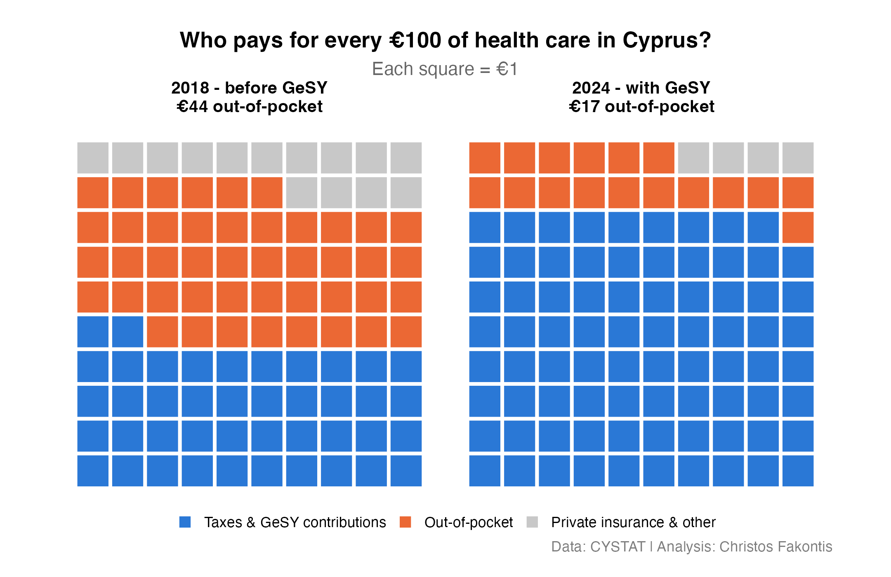
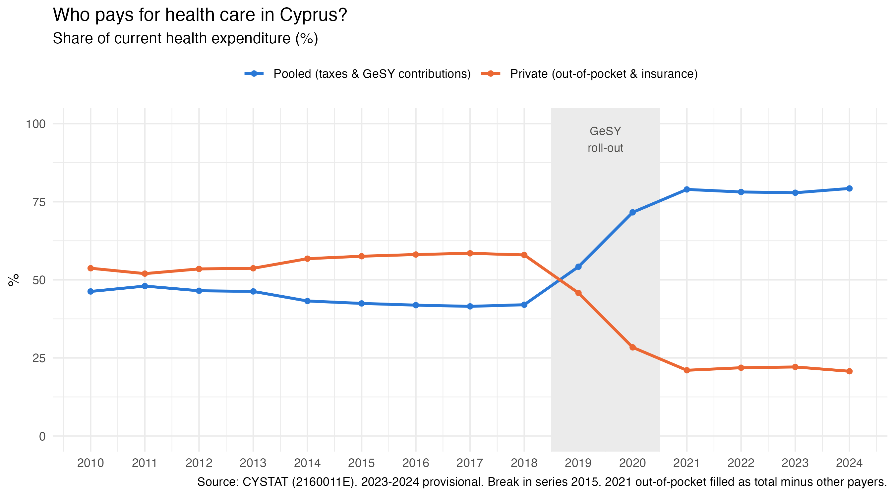
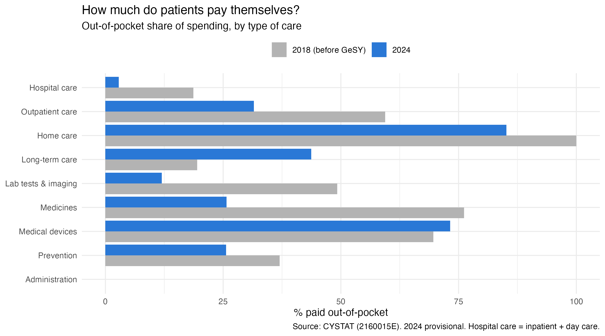
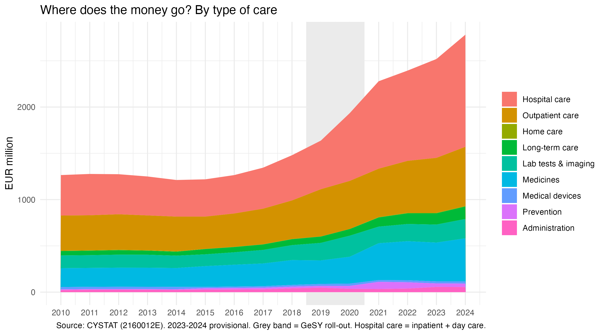
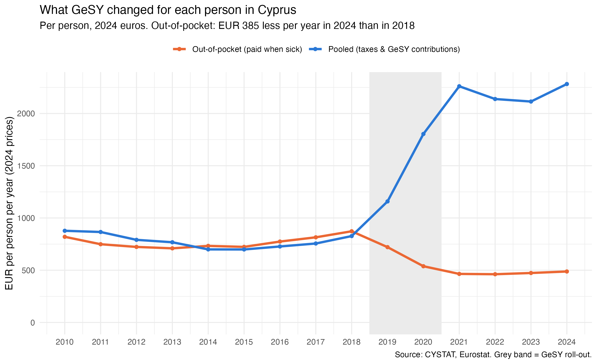
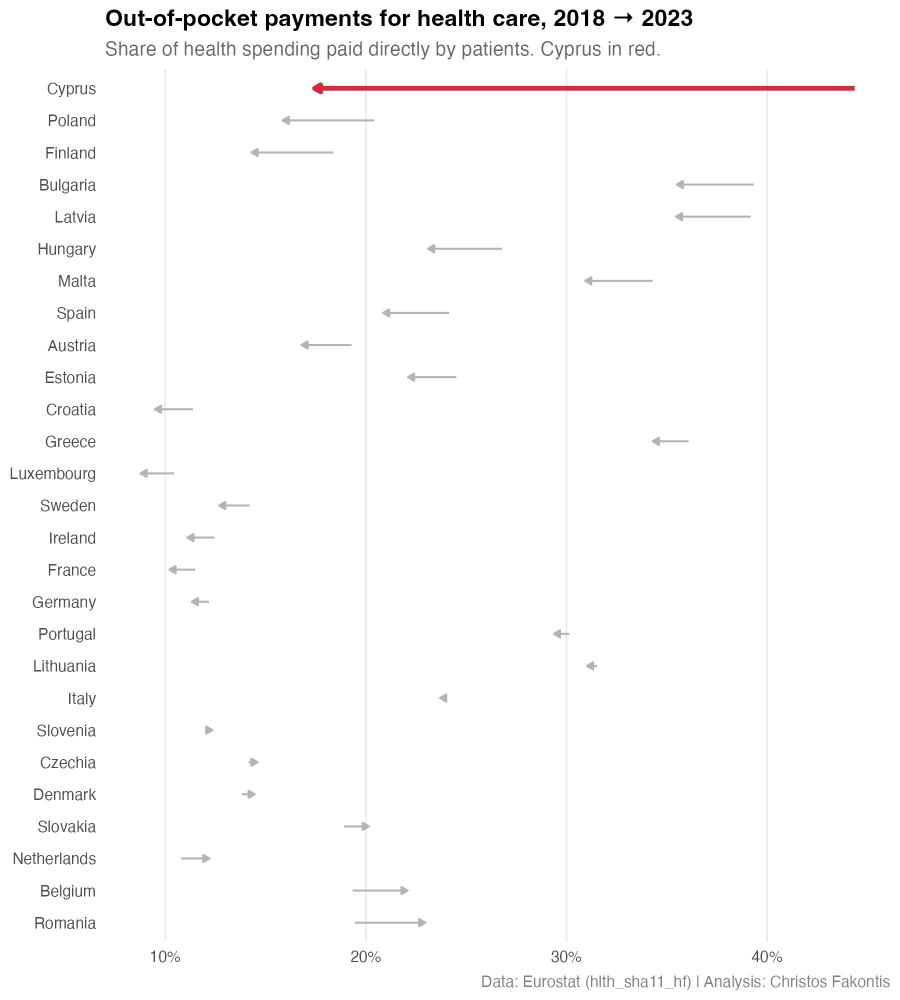
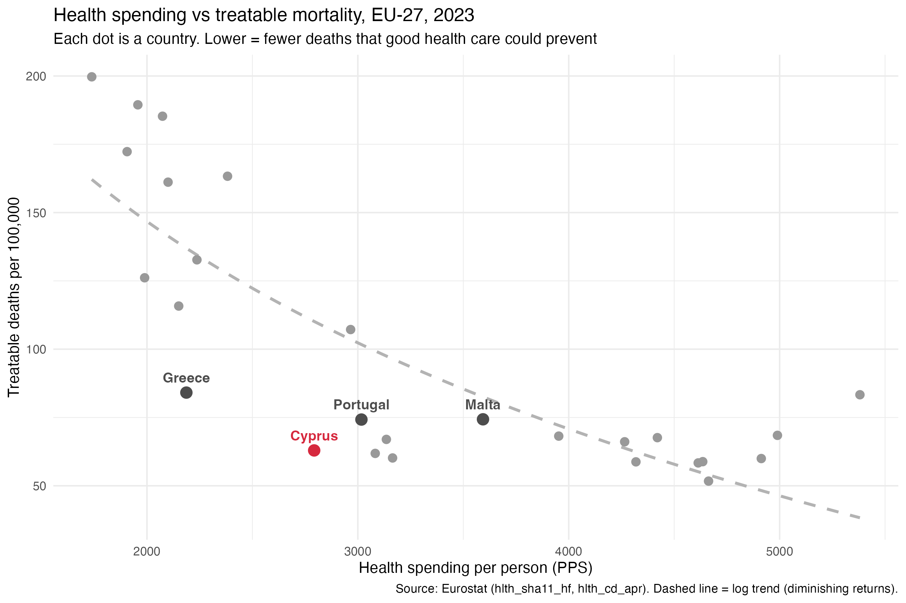
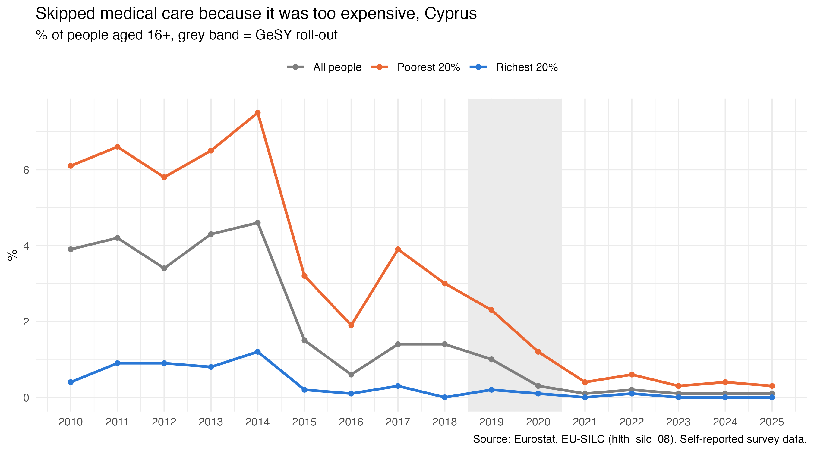
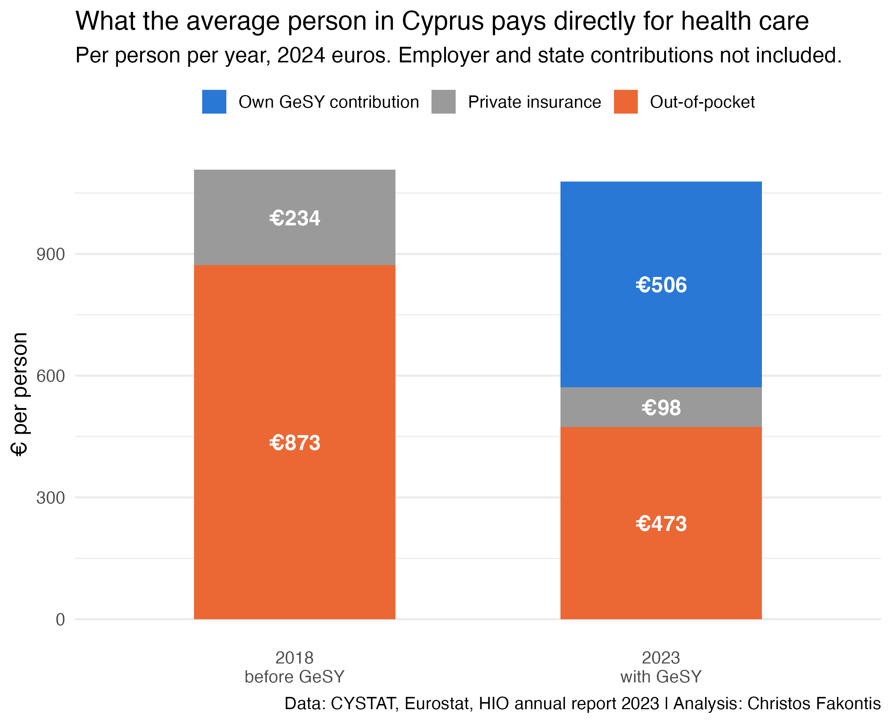

# Who pays for health care in Cyprus? Health spending before and after GeSY (2010–2024)

An end-to-end health economics project in **R**: official health accounts data from CYSTAT and Eurostat are downloaded, cleaned, validated and analysed, and the results are shown in an **interactive Shiny dashboard**.

**Research question:** *Where does Cyprus's health money go, and what changed with the General Healthcare System (GeSY)?*

> 🔗 **Live dashboard:** *(add link after publishing)*
> 📊 **Main figures:** [`outputs/figures/`](outputs/figures)



---

## Key findings

**1. GeSY flipped who pays.** In 2018, patients paid **44%** of all health spending out of their own pocket, more than the state. By 2024, **79%** was paid through taxes and GeSY contributions, and out-of-pocket fell to **17%**.

**2. It was the biggest change in the EU.** Between 2018 and 2023, Cyprus's out-of-pocket share fell by **27 points**. The second-largest fall in the EU (Poland) was under 5 points.

**3. The effect is not explained by COVID or inflation.** A difference-in-differences comparison with Greece, Malta and Portugal (2016–18 vs 2022–24) gives a **−25-point** effect on the out-of-pocket share and **+35 points** on the pooled share.

**4. Patients pay much less at the point of care.**

| Out-of-pocket share | 2018 | 2024 |
|---|---:|---:|
| Hospital care | 19% | 3% |
| Medicines | 76% | 26% |
| Lab tests & imaging | 49% | 12% |
| Outpatient care | 59% | 31% |

Per person (2024 euros), out-of-pocket fell from **€873 to €488** a year, with the largest savings on medicines (−€148) and outpatient care (−€121).

**5. Cost no longer stops the poor from seeing a doctor.** The poorest 20% who skipped care because of cost fell from **7.5% (2014)** to **0.3% (2025)**, and the gap with the richest 20% almost closed. The improvement started in 2015, before GeSY, and GeSY completed it.

**6. GeSY did not make health care cheaper.** Counting their own GeSY contributions, the average person pays about the same as before (**€1,107 in 2018 vs €1,078 in 2023**), but for **38% more care**. GeSY changed *how* people pay: a fixed share of income instead of unpredictable bills when sick.

**7. Spending grew, and moved towards hospitals.** Real spending per person rose **46%** (2018–2024). Hospital care grew **+148%**, compared with **+53%** for outpatient care, and hospitals now receive half of all health money.

**8. Gaps remain.** Outpatient care is still the largest out-of-pocket item (€202m in 2024). Out-of-pocket spending on long-term care rose **51%** between 2021 and 2024, mostly for home-based care, where families now pay about half.

**9. Good results for the money.** Cyprus spends less than the EU average per person (about 85%) and **7.7% of GDP** (EU: about 10%), yet ranks **8th of 27** in treatable mortality (2023). This was already true before GeSY, so it is not attributed to it.

> **Verdict: fairer, not cheaper.** GeSY moved the cost of care from the sick person at the point of care to everyone, through income-based contributions. It protects patients financially and closed the income gap in access. Long-term care, outpatient costs, efficiency and waiting times remain open questions.

---

## Figures

| | |
|---|---|
|  |  |
|  |  |
|  |  |
|  |  |

An interactive Sankey diagram of money flows (payers → providers → types of care) is saved as `outputs/figures/14_sankey_2024.html`.

---

## Data

| Source | Content |
|---|---|
| **CYSTAT** health accounts, tables 2160010E–2160017E (PxWeb API) | Current health expenditure by financing scheme, type of care and provider, and their combinations, EUR million, 2010–2024 |
| **Eurostat** `nama_10_gdp`, `demo_gind`, `prc_hicp_aind` | GDP, population, consumer prices (Cyprus) |
| **Eurostat** `hlth_sha11_hf` | Health spending for all EU countries (% of GDP, per person in PPS, public and out-of-pocket shares) |
| **Eurostat** `hlth_cd_apr`, `demo_mlexpec` | Treatable and preventable mortality, life expectancy |
| **Eurostat** `hlth_silc_08` (EU-SILC) | Self-reported unmet needs for medical care, by income group |
| **HIO (GeSY)** annual report 2023, budget 2022 | GeSY contributions and who pays them |

All data follow the international **System of Health Accounts (SHA 2011)** used by Eurostat, the OECD and the WHO.

---

## Methods

**Cleaning (`02_clean.R`).** The seven CYSTAT tables are renamed by meaning (column order differs between tables), years and CYSTAT flags (`b` break, `r` revised, `p` provisional) are separated, and codes are split from labels.

**Filling the 2021 gaps.** The PxWeb API returns some 2021 cells as missing. Health accounts always add up, so two accounting identities are used, after checking that they hold in every complete year:
- *Out-of-pocket = total − all other payers.* Only one payer is missing, so the value is found exactly. The result (€369.9m) matches CYSTAT's published figure.
- *Hospital care = curative care − outpatient − home care.* Inpatient and day care are both missing in 2021, so only their sum is known. They are joined into one category, "Hospital care", for all years. This also neutralises CYSTAT's 2021 reclassification between the two.

26 values were filled, all flagged with `imputed = TRUE`.

**Validation.** The three views of the accounts (financing, type of care, provider) reconcile to the same total every year, and the money flows (payers → providers → types of care) balance in every year. The financing shares match Eurostat exactly (e.g. 79.3% pooled, 17.0% out-of-pocket in 2024).

**Analysis.**
- Pooled (government + GeSY) vs private (voluntary insurance, non-profit, employers, out-of-pocket) shares.
- Real prices with the HICP (2024 = 1), and per-person figures using Eurostat population.
- Difference-in-differences: Cyprus vs the average of Greece, Malta and Portugal, 2016–18 (before) vs 2022–24 (after). The roll-out and COVID years 2019–2021 are excluded.
- Household direct burden: out-of-pocket + private insurance + the share of GeSY contributions paid by employees, pensioners and other earners (31%, HIO budget 2022).
- A 13-item scorecard against the WHO health-system goals, combining this analysis with published sources (WHO/Observatory, HIO, ILO, press surveys).

---

## Limitations

- **Breaks in series** in 2015 (whole table) and 2021 (single cells). Part of the 2021 jump in long-term care out-of-pocket spending is methodological.
- **Provisional data** for 2023–2024.
- **COVID-19** coincided with GeSY's hospital phase (2020–2021).
- **Not causal proof.** The difference-in-differences assumes Cyprus would have followed the comparators' trend without GeSY, and uses only three comparator countries without confidence intervals. On unmet needs it cannot show an effect, because Cyprus started close to zero (floor effect).
- **Household burden is an estimate:** it uses a single year of contributions and an average per resident, not by income group.
- **Ecological comparisons** between countries do not account for differences in age, income or lifestyle.

---

## How to reproduce

1. Install R (4.1 or later) and RStudio.
2. Install the packages once:
   ```r
   install.packages(c("tidyverse", "pxweb", "eurostat", "plotly", "htmlwidgets",
                      "shiny", "bslib", "bsicons"))
   ```
3. Open the project folder in RStudio and run the scripts in `R/` in order,
   from `01_download.R` to `16_money_flows.R`:
   ```r
   for (s in sort(list.files("R", full.names = TRUE))) source(s)
   ```
4. Copy the results to the dashboard folder and open the dashboard:
   ```r
   file.copy(list.files("data/processed", pattern = "csv$", full.names = TRUE),
             "app/data", overwrite = TRUE)
   shiny::runApp("app")
   ```

---

## Project structure

```
Cyprus_Healthcare_Expenditure/
├── R/
│   ├── 01_download.R             # CYSTAT (PxWeb API) + Eurostat
│   ├── 02_clean.R                # clean, fill 2021 gaps, validate
│   ├── 03_labels.R               # names, GeSY timeline, colours
│   ├── 04_public_private.R       # who pays: pooled vs private
│   ├── 05_out_of_pocket.R        # out-of-pocket by type of care
│   ├── 06_where_money_goes.R     # spending by type of care and provider
│   ├── 07_gdp_per_capita.R       # % of GDP, per person
│   ├── 08_eu_comparison.R        # Cyprus vs Greece, Malta, Portugal, EU
│   ├── 09_real_prices.R          # inflation removed (2024 euros)
│   ├── 10_unmet_needs.R          # skipped care because of cost
│   ├── 11_eu_spending_outcomes.R # 27 EU countries: spending vs mortality
│   ├── 12_verdict.R              # difference-in-differences + scorecard
│   ├── 13_citizen_gain.R         # what changed for each person
│   ├── 14_linkedin_visuals.R     # summary charts
│   ├── 15_household_burden.R     # direct burden incl. own contributions
│   └── 16_money_flows.R          # Sankey: payers -> providers -> care
├── data/
│   ├── raw/                      # downloaded data
│   └── processed/                # clean tables and results (CSV)
├── outputs/figures/              # PNG figures and interactive Sankey
└── app/
    ├── app.R                     # Shiny dashboard
    └── data/                     # copies of the result CSVs
```

---

## Author

**Christos Fakontis**, physiotherapist and PhD candidate, working on health economics and health data analysis.

*Data: Statistical Service of Cyprus (CYSTAT), Eurostat, Health Insurance Organisation (HIO). All interpretations are the author's own.*